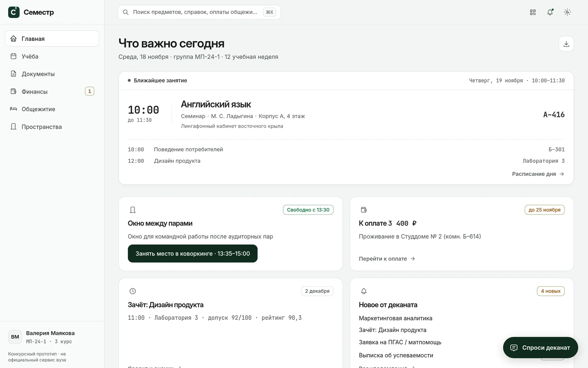
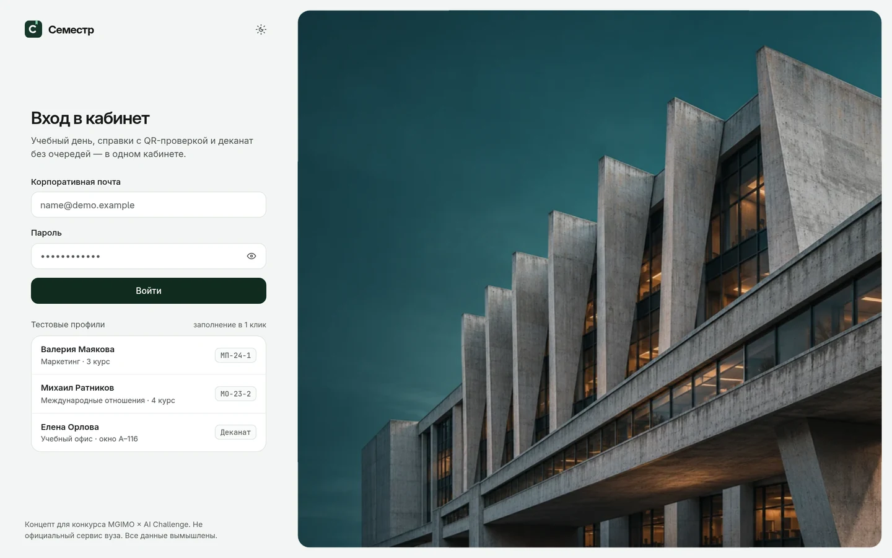
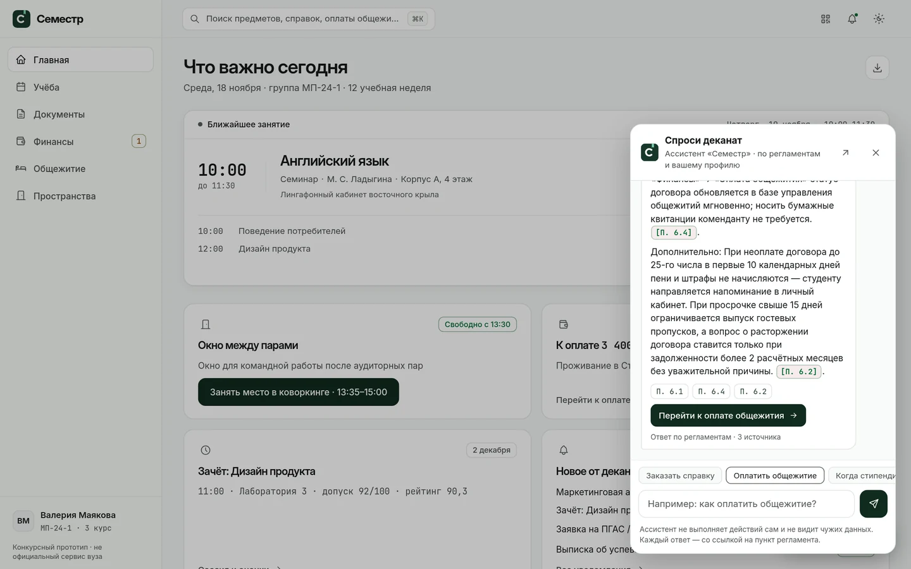
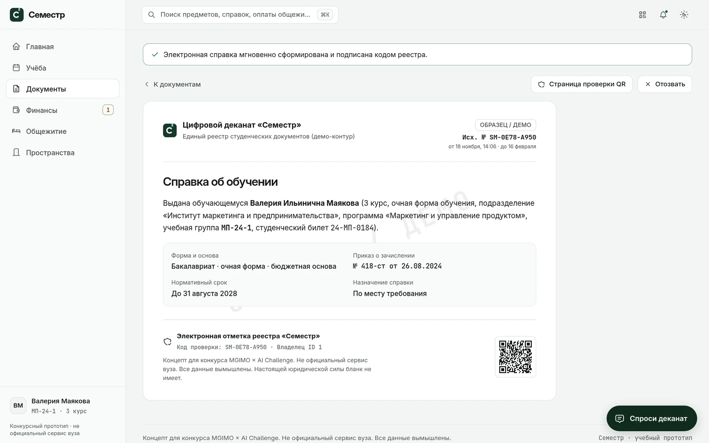
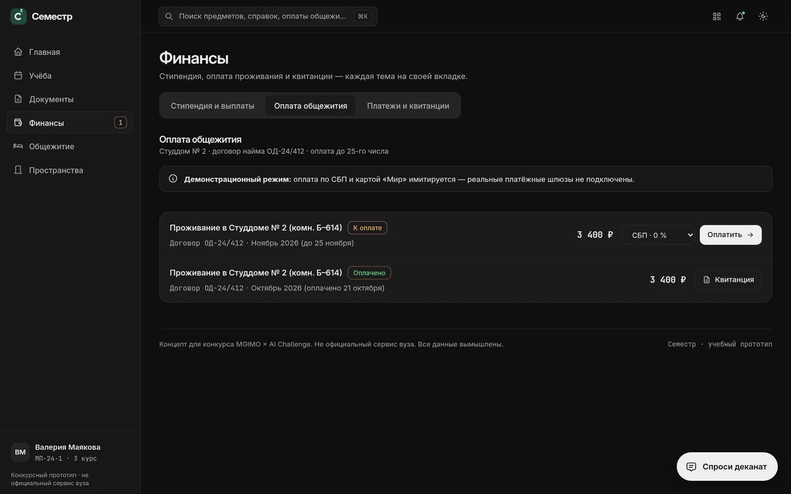
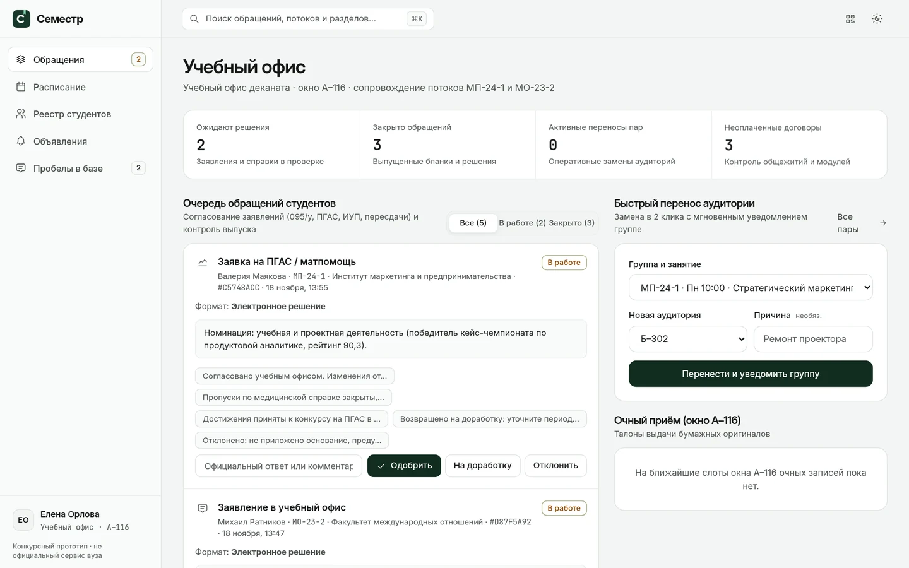
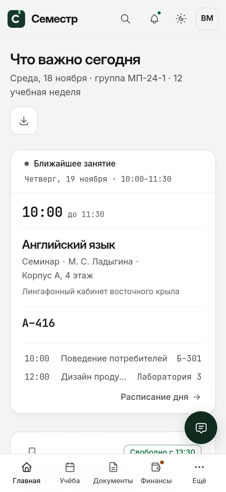
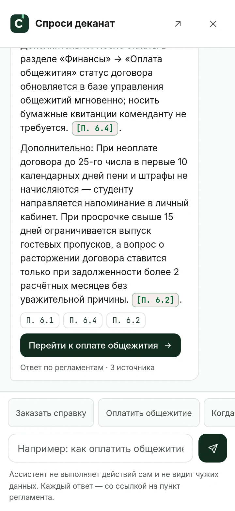
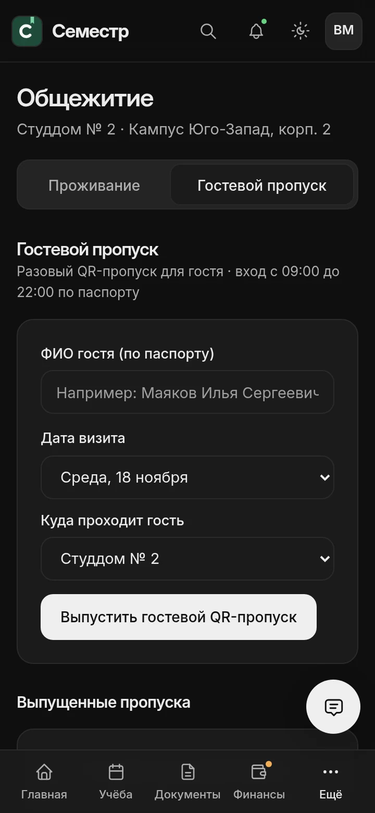
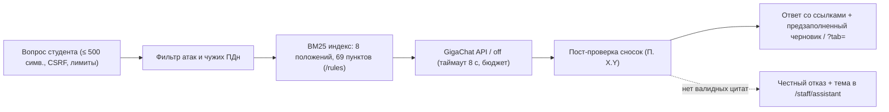

<p align="center">
  <a href="https://semestr.iamcp.ru">
    <picture>
      <source media="(prefers-color-scheme: dark)" srcset="docs/assets/logo-horizontal-dark.svg">
      
    </picture>
  </a>
</p>

<h3 align="center">Учебный день, справки с QR-проверкой и деканат без очередей — в одном кабинете.</h3>

<p align="center">
  Рабочий прототип цифрового деканата: расписание и сессия, мгновенные электронные бланки,<br>
  финансы, общежитие, бронирование пространств и ИИ-ассистент со строгим цитированием регламентов.
</p>

<p align="center">
  <a href="https://semestr.iamcp.ru"></a>
  <a href="#ассистент-спроси-деканат"></a>
  <a href="#структура-репозитория"></a>
</p>

<p align="center">
  <a href="https://docs.python.org/3.13/"></a>
  <a href="https://flask.palletsprojects.com/"></a>
  <a href="https://www.sqlite.org/wal.html"></a>
  <a href="docs/assistant-eval.md"></a>
  <a href="Caddyfile"></a>
  <a href="tests/"></a>
</p>

<p align="center">
  <a href="https://semestr.iamcp.ru">
    <picture>
      <source media="(prefers-color-scheme: dark)" srcset="docs/images/hero-dark.webp">
      
    </picture>
  </a>
</p>

---

> [!NOTE]
> **Статус проекта.** Конкурсный прототип для **MGIMO × AI Challenge** (номинация «Вайб-кодинг», задание Института маркетинга и предпринимательства МГИМО). Не является официальным сервисом вуза: все профили студентов и сотрудников, оценки, договоры, реквизиты и 8 нормативных положений полностью вымышлены и созданы для демонстрации. Публичный стенд развёрнут в российском облаке и открывается без VPN: **[https://semestr.iamcp.ru](https://semestr.iamcp.ru)**.

| Слой | Решение |
| :--- | :--- |
| **Сервер и рендер** | `Python 3.13` · `Flask 3.1` (SSR) · `Gunicorn` (`< 2 мс` на страницу, работает без JS и с клавиатуры) |
| **Хранение данных** | `SQLite 3` в режиме `WAL` · `PRAGMA foreign_keys = ON` · идемпотентные ключи `UNIQUE(student_id, nonce)` |
| **ИИ-контур** | `BM25` по 69 пунктам положений ([`/rules`](semester/rules/corpus.py)) + `GigaChat API` (`SEMESTER_LLM=gigachat\|off`) + пост-проверка сносок `[П. X.Y]` |
| **Документы, PDF и QR** | `ReportLab` + `segno 1.6.6` · прямое скачивание серверного A4 `.pdf` со сканируемым QR · публичный реестр `/verify/*` с маскированием ФИО |
| **Интерфейс и темы** | Спокойная шкала `oklch`, светлая и спроектированная тёмная темы, `360–1440 px` без горизонтального скролла |
| **Типографика и знаки** | Самохостинг под `CSP default-src 'self'`: `Inter Display` + `Adwaita Sans` + `JetBrains Mono` (`SIL OFL 1.1`), `Tabler Icons` (`MIT`) |
| **Инфраструктура** | `Docker Compose` · `Caddy 2` (HTTP/2 + HTTP/3, Let's Encrypt, `HSTS`) · автосброс демо-базы каждые `45 мин` (`systemd timer`) · `GitHub Actions CI` |

## Зачем

Учебная рутина студента обычно разорвана между статичным расписанием на сайте кафедры, отдельной ведомостью, бумажными очередями за справками и объявлениями в пересылках старост. На экране смартфона найти актуальную аудиторию, срок подачи 095/у или реквизиты оплаты общежития трудно.

| Типичный путь сейчас | Как решено в «Семестре» |
| :--- | :--- |
| Поиск переноса пары между сайтом и чатами потока | Первый экран **«Что важно сегодня»** показывает ближайшую пару, маршрут до зала, перенос аудитории и окно для брони коворкинга в 1 клик |
| Очный поход в деканат и ожидание справки 2–3 дня | Мгновенный выпуск электронного бланка и серверного `.pdf` с верифицируемым QR (`/verify/<token>`) либо запись по талону в `А–116` |
| Смешение разнородных форм и таблиц на одной простыне | Правило **«один экран — одна тема»**: каждый раздел разбит на чистые SSR-подвкладки с прямым адресом `?tab=` |
| Несоответствие услуг профилю студента | Каталог зависит от данных профиля: воинский учёт (`Прил. № 4`) — только состоящим на ВУС, стипендия — бюджетникам, оплата найма — проживающим |
| Домыслы чат-ботов по учебным правилам | Ассистент **«Спроси деканат»** отвечает строго со сносками `[П. X.Y]` и предзаполняет черновик многопольного заявления прямо из диалога |

## Как это выглядит

### Ноутбук — кабинет студента и учебный офис

<table>
  <tr>
    <td width="50%">
      <br>
      <sub><b>Вход в кабинет</b> — собственный знак марки, переключение темы и быстрый выбор демо-профиля</sub>
    </td>
    <td width="50%">
      <br>
      <sub><b>«Спроси деканат»</b> — ответ по регламентам со сносками <code>[П. 6.4]</code>, <code>[П. 6.2]</code> и прямой кнопкой в оплату</sub>
    </td>
  </tr>
  <tr>
    <td width="50%">
      <br>
      <sub><b>Электронная справка с QR</b> — печатный бланк и публичная проверка действительности без раскрытия ПДн</sub>
    </td>
    <td width="50%">
      <br>
      <sub><b>Финансы · тёмная тема</b> — монохромная шкала <code>oklch</code>, раздельная вкладка оплаты общежития <code>?tab=dorm</code></sub>
    </td>
  </tr>
  <tr>
    <td colspan="2">
      <br>
      <sub><b>Учебный офис (<code>/staff</code>)</b> — очередь обращений студентов с готовыми пресетами решений, перенос аудитории в 2 клика с уведомлением группы и обезличенный журнал пробелов в регламентах</sub>
    </td>
  </tr>
</table>

### Телефон — полноценная работа от 360 px

<table>
  <tr>
    <td width="33%">
      <br>
      <sub><b>Что важно сегодня</b> — ближайшая пара, корпус и навигация одной рукой</sub>
    </td>
    <td width="33%">
      <br>
      <sub><b>Чат деканата</b> — быстрые темы и проверенные ссылки на статьи положений</sub>
    </td>
    <td width="33%">
      <br>
      <sub><b>Гостевой пропуск</b> — выпуск разового QR для прохода гостя в студдом</sub>
    </td>
  </tr>
</table>

## Информационная архитектура

Принцип интерфейса: **один экран — одна тема**, без двух несвязанных форм рядом. Верхние разделы студента делятся на адресные подвкладки (`?tab=`), которые рендерятся на сервере (SSR), работают без JavaScript, переключаются с клавиатуры и служат точными целями (deep links) для кнопок ассистента и поиска `⌘K`.

| Раздел | Подвкладки и адреса | Назначение |
| :--- | :--- | :--- |
| **Главная** | [`/`](semester/templates/home.html) | Ближайшая пара, окно для коворкинга, счёт к оплате, ближайший зачёт и лента деканата |
| **Учёба** | `/schedule` · `/grades` | Расписание дня и недели (с экспортом `.ics`), переносы аудиторий, 100-балльный рейтинг и ЗЕТ |
| **Документы** | `/requests?tab=order` · `/requests?tab=mine` · `*.pdf` | Мгновенные справки с QR и скачиванием серверного `.pdf`, многопольные заявления и запись в окно `А–116` |
| **Финансы** | `/finance?tab=scholarship` · `?tab=dorm` · `/campus/sbp/*` | Стипендия ГАС, пошаговая симуляция СБП (`создан → ожидает → оплачен`), дополнительные модули и квитанции |
| **Общежитие** | `/dorm?tab=living` · `/dorm?tab=guest` | Карточка проживания, контакты коменданта, справка из студдома и разовые гостевые QR-пропуска |
| **Пространства** | `/spaces?tab=rooms` · `/spaces?tab=cowork` | Бронирование закрытых переговорных / медиастудии и открытых рабочих мест между парами |
| **Учебный офис** | `/staff` · `/staff/schedule` · `/staff/students` · `/staff/notices` · `/staff/assistant` | Рабочее место методиста: согласование заявок, замены аудиторий, объявления потокам и пробелы базы |

## Ассистент «Спроси деканат»

На всех страницах студента доступна плавающая панель ассистента (без JS ведёт на полноэкранный [`/assistant`](semester/templates/assistant.html)). Конвейер спроектирован так, чтобы исключить выдуманные сроки, утечку чужих данных и несанкционированные действия:



- **Строгое цитирование:** каждое содержательное утверждение обязано ссылаться на реально найденный пункт вида `[П. 3.1]` (кликабельный переход на `/rules#p-3-1`). Абзацы без валидной ссылки из выдачи `BM25` вырезаются пост-проверкой; если подтверждённых пунктов нет, возвращается честный статус *«В регламентах этого нет»* с кнопкой обращения в учебный офис, а обезличенная тема фиксируется в `/staff/assistant`.
- **Защита и бюджет:** лимит `10` вопросов/мин и `60`/день на студента + общий лимит на IP (`HTTP 429`), дневной потолок `SEMESTER_LLM_DAILY_TOKENS` в SQLite с автоматическим откатом в детерминированный режим `off`, память из последних `6` реплик. В модель передаются только обезличенные академические поля текущего профиля (курс, программа, основа обучения, рейтинг, ЗЕТ, сумма к оплате) — без ФИО, почты, телефона и номеров документов.
- **Предзаполнение многопольных заявлений из диалога:** по контексту беседы и найденному пункту положения ассистент сам формирует черновик заявления (`095/у` / ЕМИАС, ПГАС, направление на пересдачу, академический отпуск, переход на бюджет, апелляция) с подстановкой дат, медучреждения, дисциплины семестра и ссылки на `П. X.Y` — студенту остаётся проверить поля и нажать «Отправить заявку».
- **Живой прогон на продакшене (`SEMESTER_LLM=gigachat`):** `9/9` эталонных вопросов прошли пост-проверку цитат (`0,7–2,4 с`), вопрос вне базы вернул отказ без галлюцинаций, `5` прямых и `2` скрытые prompt-injection атаки отражены. Полный протокол замеров — [`docs/assistant-eval.md`](docs/assistant-eval.md).

## Структура репозитория

```text
semester/
├── semester/                        # Пакет веб-приложения (Flask SSR)
│   ├── __init__.py                  # Фабрика приложения, сессии, CSRF, rate-limit, все маршруты и CLI
│   ├── db.py                        # Схема SQLite WAL, идемпотентные миграции, сиды и reset_demo_data()
│   ├── demo.py                      # Вымышленные профили, расписание, ведомости, правила доступности и SVG QR
│   ├── pdf.py                       # Серверная вёрстка A4 PDF-справок с векторным QR, таблицами и водяным знаком
│   ├── rag.py                       # BM25-поиск, клиент GigaChat, проверка цитат и сборка черновиков заявлений
│   ├── rules/
│   │   └── corpus.py                # 8 вымышленных положений «Семестра» (69 пунктов с якорями и deep links)
│   ├── certs/
│   │   └── russian_trusted_ca.pem   # Публичная цепочка НУЦ Минцифры для строгой TLS-проверки GigaChat API
│   ├── templates/                   # Jinja2-шаблоны (строго без inline style/script под CSP)
│   └── static/                      # Токены и стили portal.css, интерактив portal.js, шрифты OFL, иконки и манифест
├── tests/                           # Автотесты (85 passed в pytest)
│   ├── test_portal.py               # Сессии, CSRF, IDOR (404), оплата, QR-верификация, /staff, CSP и фавиконки
│   ├── test_assistant.py            # 18 эталонных вопросов, 5 вне базы, 12 атак, лимиты, бюджет токенов и память
│   └── test_consistency.py          # Согласованность сид-данных: пол, курс, бюджет/договор, общежитие, ВУС
├── deploy/                          # Эксплуатация продакшена (bootstrap, бэкап SQLite, healthcheck, 45-мин reset-demo timer)
├── docs/                            # Документация разработки, оценка ИИ и иллюстрации
│   ├── assistant-eval.md            # Таблица живого прогона GigaChat на продакшене (вопросы и атаки)
│   ├── critique-and-typography.md   # Выбор OFL-типографики и независимое продуктовое/жюри-ревью
│   ├── ai-process.md                # Журнал инженерного процесса и работы с ИИ-агентами
│   ├── assets/                      # Векторная марка, кнопки и бейджи стека для README
│   └── images/                      # Скриншоты десктопной и мобильной (360 px) версий в WebP
├── Dockerfile                       # Непривилегированный образ Python 3.13 + Gunicorn (uid 10001)
├── compose.yaml                     # Оркестрация контейнеров app + Caddy 2 с постоянными томами
├── Caddyfile                        # Конфигурация TLS, HTTP/3 и проксирования домена
└── deploy.sh                        # Идемпотентный деплой одной командой без перезаписи серверного .env
```

### Ключевые файлы для чтения кода

| Файл | Роль в системе |
| :--- | :--- |
| [`semester/__init__.py`](semester/__init__.py) | Вход и хранение `SHA-256` сессий, проверка прав владельца, SSR-подвкладки, JSON/HTML ответы чата и CLI (`reset-demo`, `assistant-eval`) |
| [`semester/pdf.py`](semester/pdf.py) | Генератор официальных A4 `.pdf`-справок (`ReportLab` + `segno`) с векторным QR, маской ФИО и таблицами оценок/выплат |
| [`semester/rag.py`](semester/rag.py) | `BM25`-индекс, вызов `GigaChat`, `post_verify_answer()` и синтез черновика заявления `build_petition_draft()` |
| [`semester/rules/corpus.py`](semester/rules/corpus.py) | Нормативный корпус из 8 положений (`1.1`–`8.9`) с привязкой к действиям и подвкладкам кабинета |
| [`semester/db.py`](semester/db.py) | Таблицы заявок, начислений, броней, замен аудиторий, истории диалогов, обезличенных пробелов и суточного расхода токенов |
| [`semester/demo.py`](semester/demo.py) | Генератор учебных недель по МСК, `.ics`-календаря, матричных QR-кодов `segno` и функция `eligibility(student_id)` |
| [`semester/static/portal.css`](semester/static/portal.css) | Дизайн-система на `oklch`, адаптивная сетка `360–1440 px`, печатный лист справки `@media print` |
| [`tests/test_assistant.py`](tests/test_assistant.py) | Полная матрица проверок RAG-ассистента: точность цитирования, отражение инъекций, квоты и откат в `off` |
| [`tests/test_consistency.py`](tests/test_consistency.py) | Автоматическая сверка курсов, годов поступления, стипендий и воинского учёта по всем профилям и шаблонам |

## Быстрый старт

Требуется **Python 3.11+** со встроенным `sqlite3` (3.35+). Никаких внешних ключей для локального запуска не нужно — при `SEMESTER_LLM=off` ассистент работает автономно по локальному индексу регламентов.

```bash
git clone https://github.com/artemmalanin979-create/semester.git
cd semester
python3 -m venv .venv
source .venv/bin/activate
python -m pip install -r requirements.txt
flask --app semester run --port 8765
```

Откройте `http://127.0.0.1:8765`. На локальном стенде любой из трёх демонстрационных аккаунтов заполняется на странице входа в 1 клик:

| Профиль | Роль и параметры | Почта | Локальный пароль |
| :--- | :--- | :--- | :--- |
| **Валерия Маякова** | Студент · `МП-24-1` (Маркетинг, 3 курс, бюджет, общежитие) | `lera@demo.example` | `Semestr-Lera-26` |
| **Михаил Ратников** | Студент · `МО-23-2` (МО, 4 курс, бюджет, общежитие, воинский учёт) | `misha@demo.example` | `Semestr-Misha-26` |
| **Елена Орлова** | Сотрудник · Учебный офис (`А–116`) | `dean@demo.example` | `Semestr-Dean-26` |

### Запуск автотестов и сервисных команд

```bash
python -m pip install pytest opencv-python-headless
pytest -v                                  # 85 тестов: безопасность, PDF/QR, СБП, RAG-черновики, инъекции, согласованность
flask --app semester reset-demo            # сброс демо-данных к чистому состоянию с сохранением password_hash
```

## Продакшен-деплой (Docker Compose + Caddy 2)

В продакшене (`SEMESTER_ENV=production`) демонстрационные пароли и опциональный ключ `GIGACHAT_AUTH_KEY` задаются только в `/opt/semestr/.env` (`chmod 600`) на сервере, хранятся в БД как `scrypt`-хэши и никогда не попадают в git или HTML.

```bash
cp .env.example .env                       # заполнить SEMESTER_SECRET, пароли и при необходимости GIGACHAT_AUTH_KEY
./deploy.sh deploy@<server-host>           # rsync без перезаписи .env → docker compose build/up → проверка /healthz
```

- **Автоматический мягкий сброс демо-данных (каждые 45 минут):** на продакшене `systemd`-таймер [`deploy/semester-reset-demo.timer`](deploy/semester-reset-demo.timer) каждые **45 минут** запускает [`deploy/reset-demo.sh`](deploy/reset-demo.sh), возвращая заявки, счета СБП, бронирования и очередь `/staff` к исходному демонстрационному состоянию. Это сделано специально для того, чтобы каждый эксперт жюри видел одинаковую чистую стартовую картину (неоплаченный счёт за общежитие, ожидающие решения заявления в `/staff`), при этом хэши паролей и активные `login_sessions` сохраняются — проверяющего не выбрасывает из кабинета. Сбросить базу вручную в любой момент можно командой:
  ```bash
  flask --app semester reset-demo          # локально
  docker compose exec -T app flask --app semester reset-demo   # на сервере
  ```
- **Масштабирование до уровня вуза:** для автономного стенда связка `Flask SSR + SQLite WAL` обеспечивает отклик `< 2 мс` и атомарный онлайн-бэкап файла БД ([`deploy/backup-sqlite.sh`](deploy/backup-sqlite.sh)). При переходе на нагрузку университета (`10 000+` студентов и несколько реплик за балансировщиком) слой хранения переключается через `DATABASE_URL` на `PostgreSQL` (`psycopg 3` + `Alembic`) без переписывания доменной логики: схема уже опирается на стандартные типы, внешние ключи и серверные сессии.

## Безопасность и лицензии материалов

- **Защита сессий и данных:** пароли хэшируются алгоритмом `scrypt`; `HttpOnly + Secure + SameSite=Lax` cookie содержит случайный токен, в БД хранится только его `SHA-256` с мгновенным отзывом при выходе; каждый запрос к заявкам, справкам, квитанциям, пропускам и истории чата проверяет `student_id` владельца (`404` при подстановке чужого идентификатора).
- **Заголовки и лимиты:** `Content-Security-Policy: default-src 'self'; object-src 'none'; base-uri 'none'; frame-ancestors 'none'; form-action 'self'` (ноль inline-стилей и скриптов), `HSTS`, `X-Content-Type-Options: nosniff`, `X-Frame-Options: DENY`, CSRF-токены на всех `POST`-формах, rate-limit на вход (`5` ошибок за `10` минут → `429`) и на запросы к ИИ.
- **Открытые лицензии всех ассетов:**
  - шрифты `Inter Display` ([`OFL-InterDisplay.txt`](semester/static/OFL-InterDisplay.txt)), `Adwaita Sans` ([`LICENSE-ADWAITA.txt`](semester/static/LICENSE-ADWAITA.txt)) и `JetBrains Mono` ([`OFL-JetBrainsMono.txt`](semester/static/OFL-JetBrainsMono.txt)) — `SIL Open Font License 1.1`;
  - иконки интерфейса `Tabler Icons` ([`LICENSE-TABLER.txt`](semester/static/LICENSE-TABLER.txt)) — `MIT License`;
  - генератор QR-кодов `segno` ([`LICENSE-SEGNO.txt`](semester/static/LICENSE-SEGNO.txt)) — `BSD-3-Clause`;
  - знак марки «Семестр» и иллюстрация модернистского корпуса (`campus.webp`) созданы специально для проекта и не копируют символику или здания реальных вузов.

## Автор

<table>
  <tr>
    <td align="center" width="104">
      <a href="https://github.com/artemmalanin979-create"></a>
    </td>
    <td>
      <strong>Артём Маланин</strong><br>
      Капитан проекта «Семестр» · MGIMO × AI Challenge<br>
      <a href="https://github.com/artemmalanin979-create">GitHub</a> · <a href="https://www.linkedin.com/in/artem-malanin-3a9818420">LinkedIn</a> · <a href="https://x.com/ArtemMalaninDev">X</a>
    </td>
  </tr>
</table>
